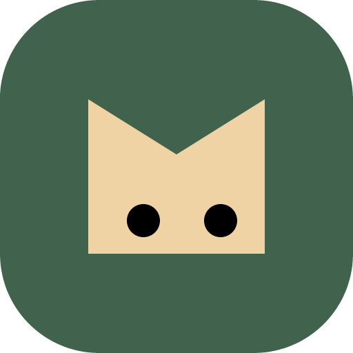

<p align="center">
  
</p>

<h1 align="center">Our Pets</h1>

<p align="center">
  Small companions on your desktop. Shared moments on your local network.
</p>

<p align="center">
  <a href="https://github.com/jiind/our-pets/releases"></a>
  <a href="https://github.com/jiind/our-pets/actions/workflows/ci.yml"></a>
  <a href="LICENSE"></a>
</p>

<p align="center">
  <a href="https://github.com/jiind/our-pets/releases"><strong>Download beta</strong></a> ·
  <a href="docs/usage.md">User guide</a> ·
  <a href="https://github.com/jiind/our-pets/issues">Report an issue</a> ·
  <a href="CONTRIBUTING.md">Contribute</a>
</p>

Our Pets is a desktop companion app for **Windows, macOS, and Linux**. Your pet can walk over to a friend's pet, exchange greetings and messages, or gather everyone for coffee, a meal, or a walk. It can also bring you updates from Docker, Slack, and development tools.

Connect each desktop app to one server on your local network. Use it at home, with friends, or at work. Core pet features and messages work without internet access or cloud accounts.

## Download

Get the beta package for your OS from [GitHub Releases](https://github.com/jiind/our-pets/releases). You also need one server instance on your shared local network.

| Windows | macOS | Linux |
| --- | --- | --- |
| [x64 installer · NSIS](https://github.com/jiind/our-pets/releases) | [Intel & Apple Silicon · DMG](https://github.com/jiind/our-pets/releases) | [x64 · DEB / AppImage](https://github.com/jiind/our-pets/releases) |
| WebView2 runtime | System WKWebView | GTK 3, WebKitGTK 4.1, AppIndicator, X11, and a compositor |

> **Beta status:** Windows, macOS, and Linux are the target platforms. Successful builds do not establish that desktop behavior has been verified on every OS. Native Wayland window control is not supported; Wayland sessions need XWayland and environment-specific validation. Windows code signing and macOS signing/notarization are not configured. See [platform requirements and limitations](docs/platforms.md).

Server packaging targets Linux amd64/arm64, Windows amd64, and macOS amd64/arm64.

## Features

| | What you can do |
| --- | --- |
| **Make it yours** | Choose a cat, dog, Gopher, or Ferris, or upload your own PNG or animated sprite sheet. Changing the design preserves your pet's identity. |
| **Play together** | Click any pet to pet it, drag to lift it, or greet and high-five a friend. Your pet approaches the other pet, and both react. |
| **Send a message** | Write directly in a pet's right-click menu. Your pet sends to everyone online; a friend's pet sends to that friend. Emoji and replies are supported. |
| **Gather friends** | Invite others for coffee, a smoke break, a meal, a chat, or a walk. Participating pets stay beside the host until the gathering ends. |
| **Stay informed** | Receive speech bubbles and OS notifications. Each connected device independently receives real-time user messages. |
| **Control your space** | Adjust pet size, hide pets, or show only your own. Display settings stay in sync between the app and tray menu. |

Messages and notifications are shown in real time. There is no inbox or offline message replay. If a sender's pet is hidden, their message is delivered through OS notifications only.

## Quick start

1. **Run a server.** Configure the registration code, bind address, and allowed CIDRs using the [configuration example](examples/server.env.example).
2. **Connect your apps.** Enter the server address on each PC, create an account or sign in, then choose a character to register your pet.
3. **Meet your friends.** Right-click an online friend's pet to send a message or interact.

The server defaults to `127.0.0.1:9377` and accepts loopback connections only. To connect other PCs, configure the LAN address, access range, and firewall. The server does not automatically load `.env` files: supply environment variables or use the example service's environment file. See the [deployment guide](docs/operations.md) for setup, TLS, and backups, and the [user guide](docs/usage.md) for pet controls.

## Personal notifications

After signing in, add a source from the app's notifications page. Sources run **on your PC**. Personal credentials and events are not shared with the LAN server or friends.

| Source | Updates |
| --- | --- |
| Docker Events API | Start, exit, restart, and status changes for selected containers |
| Slack Socket Mode | Messages, app mentions, and reactions within the authorized workspace and conversations |
| Codex CLI | Remaining account quota, usage thresholds, exhaustion, recovery, and refresh notifications |
| Claude Code | Usage and quota notifications received through a local status-line bridge |

External integrations receive notifications only. They do not control containers, execute external commands, or send Slack messages. Slack and Codex account queries require internet access. Claude's refresh action checks the most recent status-line payload rather than querying a remote API. See [connector setup, permissions, and storage](docs/connectors.md).

## Development

The project uses a Go server with SQLite and a Tauri 2 desktop app built with Rust and TypeScript. The Pretendard font and default characters are bundled locally; runtime CDN access is not required.

<details>
<summary><strong>Run from source</strong></summary>

Install Go 1.26+, Node.js 24, Rust stable, Python 3.10+, and the [Tauri platform prerequisites](https://v2.tauri.app/start/prerequisites/). Initial dependency installation requires internet access.

```bash
git clone https://github.com/jiind/our-pets.git
cd our-pets
```

Start the server in the first terminal. Replace the example registration code with your own private value.

```bash
export OURPETS_INVITE='replace-with-your-private-invite'
go run ./cmd/our-pets
```

On Windows PowerShell:

```powershell
$env:OURPETS_INVITE = 'replace-with-your-private-invite'
go run ./cmd/our-pets
```

Start the desktop app in a second terminal:

```bash
cd desktop
npm ci
npm run tauri dev
```

Connect to `http://127.0.0.1:9377` in the app. `npm run dev` serves the settings UI for development; run the Tauri app to use the actual desktop pets.

</details>

See [CONTRIBUTING](CONTRIBUTING.md) for checks and code conventions. CI runs Gitleaks against current files and the full Git history, Go race tests, TypeScript and UI checks, and Rust tests/builds on all three OSes. Version tags create a draft release with packages, checksums, and notices after CI and platform packaging succeed. Beta tags are marked as prereleases. See the [release guide](docs/releasing.md).

## Contributing

Bug fixes, new connectors, pet designs, and documentation improvements are welcome.

- **Bugs and ideas:** Check [existing issues](https://github.com/jiind/our-pets/issues), then share reproduction steps or your use case.
- **Code and documentation:** Read [CONTRIBUTING](CONTRIBUTING.md) and describe the resulting behavior and validation in your PR.
- **Pet artwork:** Include the creator, source, license, and redistribution terms.
- **Security:** Follow the [private reporting policy](SECURITY.md). Do not post real credentials or vulnerabilities in public issues.

## Documentation

Project documentation is in English. The app's current UI is in Korean.

| Usage and operations | Development and extensions |
| --- | --- |
| [User guide](docs/usage.md) | [Architecture](docs/architecture.md) |
| [PNG and animation registration](docs/pet-design.md) | [HTTP, WebSocket, and IPC](docs/api.md) |
| [Server deployment and backups](docs/operations.md) | [Connector setup and authoring](docs/connectors.md) |
| [Platform requirements](docs/platforms.md) | [UI and motion guidelines](docs/design-system.md) |
| [Characters and attribution](docs/character-assets.md) | [CI and releases](docs/releasing.md) |

## License

Project source code is available under the [Apache License 2.0](LICENSE). Bundled characters, fonts, and libraries retain their respective licenses. See [THIRD_PARTY_NOTICES](THIRD_PARTY_NOTICES.md) for Gopher and Ferris attribution, reference artwork, Pretendard, GSAP, and other dependencies. The GSAP runtime's Standard “No Charge” License is separate from this project's code license and the GSAP Skills documentation license.
